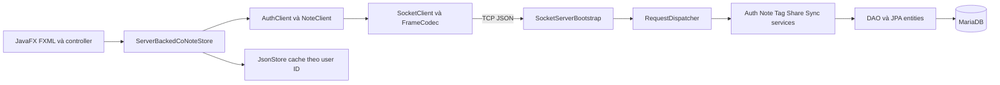
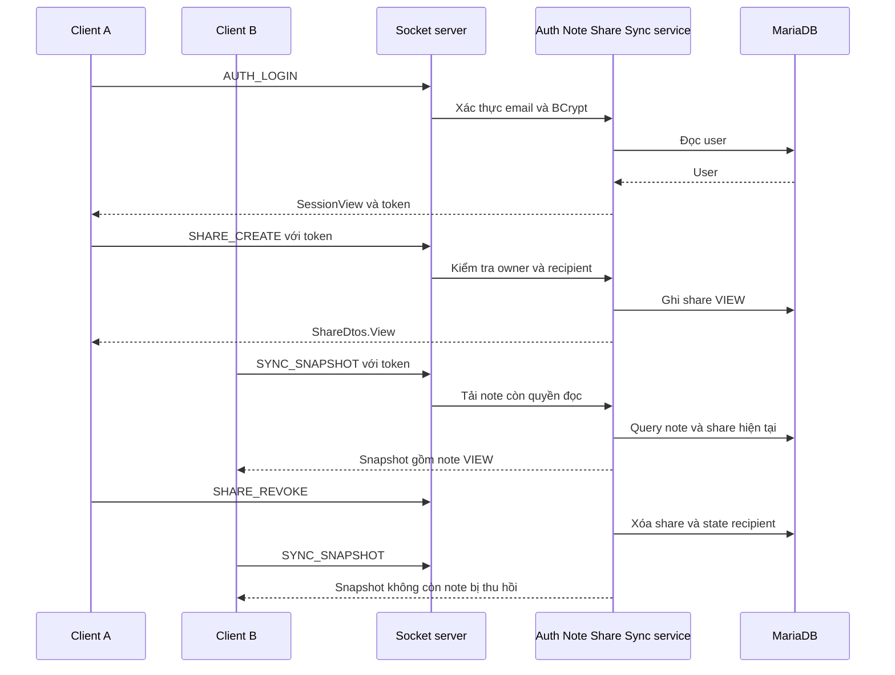
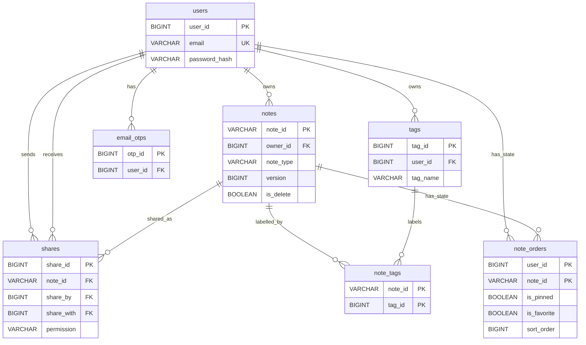

# CoNote — tài liệu dự án và hợp đồng triển khai

Đây là nguồn tài liệu thống nhất cho phạm vi, kế hoạch, hợp đồng Stage 0 và trạng thái kiểm chứng. Khi mã thay đổi, cập nhật tài liệu này trong cùng thay đổi.

## 1. Mục tiêu và nguồn yêu cầu

CoNote là đồ án **do hai thành viên thực hiện**: ứng dụng ghi chú desktop JavaFX, có tài khoản, ghi chú cá nhân và chia sẻ ghi chú giữa các tài khoản. Giao tiếp client–server dùng **`java.net.Socket` và `java.net.ServerSocket` qua TCP**, theo lựa chọn đã chốt. Server giữ dữ liệu chính trong MariaDB. Client hiện có cache JSON và hàng đợi đồng bộ, nhưng yêu cầu đề tài không đòi thao tác khi offline; phần đó được tách thành mở rộng tùy chọn.

Nguồn yêu cầu theo thứ tự ưu tiên:

1. Quyết định đã chốt: Socket/ServerSocket qua TCP.
2. Phạm vi đề tài được khóa ở AC-01…08: tài khoản, ghi chú cá nhân, quản lý, chia sẻ VIEW/EDIT, ghim ứng dụng, tìm kiếm; JavaFX + Java + MariaDB + BCrypt + JSON.
3. Mô hình dữ liệu ban đầu gồm `users`, `notes`, `shares`, `tags`, `note_tags`, `note_orders`, `email_otps`; các bổ sung bắt buộc được chốt ở mục 7.4.
4. Mã hiện có trong ba module Maven là hiện trạng để tái sử dụng, không phải bằng chứng một chức năng đã hoàn tất.
5. Kiến trúc N-layer là định hướng. Các ví dụ `library-*`, sách/PDF/chat trong tài liệu kiến trúc cũ không thuộc phạm vi CoNote.

Chưa có rubric/danh sách design pattern đã học. Khi nhận được rubric, cập nhật bảng đối chiếu ở Stage 0 trước khi chốt thiết kế pattern. `email_otps` có trong lược đồ nhưng README không yêu cầu xác thực email hay quên mật khẩu; coi OTP là phần mở rộng, chỉ làm nếu rubric hoặc nhóm xác nhận. **Đánh dấu yêu thích** có trong README, nên thuộc phạm vi bắt buộc dù schema hiện thiếu trường tương ứng.

## 2. Định nghĩa “hoàn thành”

Một bản hoàn thành phải chứng minh được các luồng sau bằng **hai tài khoản đăng nhập trên hai tiến trình client độc lập**:

| ID | Luồng nghiệm thu | Kết quả bắt buộc |
| --- | --- | --- |
| AC-01 | Đăng ký, đăng nhập, đăng xuất | Mật khẩu lưu dạng BCrypt; request cần đăng nhập bị từ chối nếu thiếu/sai token; client mở đúng dữ liệu của tài khoản. |
| AC-02 | Ghi chú cá nhân | Tạo, đọc, sửa, xóa mềm ghi chú text/checklist; tiêu đề, nội dung, thời gian tạo/sửa được giữ đúng sau khi mở lại client/server. |
| AC-03 | Quản lý ghi chú | Tìm kiếm từ khóa, phân loại bằng tag, ghim ghi chú, đánh dấu yêu thích, sắp xếp/lọc; dữ liệu và trạng thái người dùng còn sau khi đăng nhập lại. |
| AC-04 | Chia sẻ | Chủ sở hữu chia sẻ cho tài khoản đã tồn tại theo email; người nhận thấy ghi chú và quyền VIEW hoặc EDIT; chủ sở hữu đổi quyền/thu hồi được. |
| AC-05 | Phân quyền | VIEW không sửa/xóa/chia sẻ được; EDIT sửa nội dung được theo quy tắc đã ghi trong hợp đồng API; người ngoài không đọc được; server kiểm tra mọi thao tác, kể cả request tự tạo. |
| AC-06 | Nhất quán giữa client | Sửa trên client A rồi tải lại trên client B thấy dữ liệu mới; khi mất mạng client báo lỗi rõ và không báo đã lưu thành công; sửa đồng thời không âm thầm ghi đè. |
| AC-07 | Desktop | Giao diện không đứng khi mạng/DB chậm; tìm kiếm nhanh, ghim ứng dụng trên desktop và ghim ghi chú hoạt động đúng như nhãn UI. |
| AC-08 | Tái lập | Người mới có thể thiết lập DB, chạy server/client và thực hiện demo theo README; build/test chạy được với JDK được chốt. |

Một chức năng chỉ được đánh dấu xong khi có mã chạy qua toàn luồng client → Socket → server → DB → client, kiểm tra quyền ở server, và có bằng chứng kiểm thử phù hợp. UI mẫu hoặc hàng đợi JSON riêng lẻ chưa đạt tiêu chí này.

## 3. Hiện trạng và các khoảng trống chính

- Maven có `conote-common`, `conote-server`, `conote-client`; bản build dùng JDK 25. Cần đặt `JAVA_HOME` đúng JDK 25 trước khi chạy Maven.
- Server hiện dùng `ServerSocket`/`Socket`, `FrameCodec` và `RequestDispatcher`; route HTTP cũ đã được gỡ. Auth, note, tag, share và snapshot đã có handler. Các test DB và Socket ở mục 8 chứng minh luồng server, chưa thay cho demo JavaFX hai tiến trình.
- Client mở màn hình đăng ký/đăng nhập qua Socket và tách file theo user ID. `ServerBackedCoNoteStore` cùng `NoteClient` nối UI ghi chú/chia sẻ với server. Khi phát hiện ghi chú local cũ, client hỏi trước khi nhập vào tài khoản, sao lưu file cũ và giữ ID để có thể thử lại. Cần kiểm tra đủ luồng và lỗi mạng trên hai tiến trình client trước khi đánh dấu AC đạt.
- `SyncQueueStore` và `PendingSyncItem` là mã cache cũ, không có worker offline. Luồng tài khoản phải lấy server làm nguồn dữ liệu; Stage 6 còn phải kiểm tra việc giữ bản nháp và ACK khi lỗi mạng. `JsonStore` đã dùng thay file sau khi serialize thành công.
- Entity JPA chỉ ở lớp dữ liệu. Protocol dùng DTO riêng trong `conote-common`, tránh gửi password hash hoặc quan hệ JPA qua mạng.
- `dockOnDesktop` đã nối với `alwaysOnTop` và lưu theo user; cần kiểm tra hành vi trên cửa sổ thật. PDFBox/POI đã bỏ khỏi dependency; bảng `email_otps` chưa tạo luồng sản phẩm trong phạm vi hiện tại.

## 4. Cách agent thực hiện từng stage

Làm Stage 0 → 8 theo thứ tự. Với mỗi task: (1) đọc code liên quan và hợp đồng đã chốt, (2) sửa một lát cắt chạy được, (3) chạy kiểm thử đúng phạm vi, (4) cập nhật tài liệu/hợp đồng nếu thay đổi, (5) ghi kết quả và hạn chế còn lại. Không đánh dấu stage xong chỉ vì biên dịch thành công. Không tự thêm tính năng từ `architecture.txt` nếu README không yêu cầu.

Để hai thành viên phối hợp: **A** phụ trách common/server/DB, **B** phụ trách client/UX/cache; cả hai thống nhất DTO/protocol ở Stage 0–1 và cùng làm kiểm thử tích hợp ở Stage 5–8. Đây là phân công gợi ý, không phải ranh giới kỹ thuật cứng.

### Stage 0 — Khóa phạm vi, hợp đồng và baseline

**Phụ thuộc:** không có. **Đầu ra:** tài liệu yêu cầu có thể kiểm thử, danh sách quyết định thiết kế, baseline build.

1. Chuyển AC-01…08 thành ma trận yêu cầu → màn hình → thao tác protocol → service/DAO → test. Ghi rõ semantics của xóa mềm, VIEW/EDIT, ghim và yêu thích (trạng thái theo từng người dùng), lỗi mạng, xung đột, cách nhập ghi chú cục bộ đang có.
2. Chốt JSON protocol: khung TCP gồm 4 byte độ dài big-endian + JSON UTF-8; giới hạn kích thước frame; request `{requestId, operation, token, payload}`; response `{requestId, success, code, message, data}`. Định nghĩa mã lỗi ổn định như `VALIDATION`, `UNAUTHENTICATED`, `FORBIDDEN`, `NOT_FOUND`, `CONFLICT`, `UNAVAILABLE`. Quy định một request/một response, timeout, thứ tự xử lý và version của ghi chú.
3. Tạo DTO request/response trong `conote-common` cho auth, note, tag, share, sync. Quy định cách serialize thời gian, UUID, rich text/checklist; không dùng JPA entity làm payload. Định nghĩa danh sách operation và ví dụ JSON trong tài liệu protocol.
4. Đối chiếu schema với README: bổ sung `note_type`, version để chống ghi đè, trạng thái ghim/yêu thích theo user (có thể mở rộng `note_orders` hoặc bảng user-note-state). Chốt cách tạo ID ghi chú ổn định; UUID hiện tại có thể được giữ để không mất liên kết với cache cũ.
5. Lập bảng design pattern **đã học → vấn đề thực tế → class áp dụng → test/chứng cứ**. Các ứng viên có lý do rõ: Observer qua JavaFX observable properties; DAO cho DB; Command cho pending sync actions; Strategy cho các quy tắc sort nếu rubric yêu cầu. Không gọi MVC/DAO là GoF pattern nếu rubric chỉ chấm GoF; không thêm pattern chỉ để đủ số lượng.
6. Chạy baseline với JDK 25 (`mvn -version`, `mvn test`), ghi lỗi hiện hữu và điều kiện môi trường. Không sửa mã tính năng ở stage này.

**Gate:** hai thành viên có thể đọc cùng một hợp đồng mà hiểu giống nhau; bảng pattern đã đối chiếu rubric nếu có; build baseline được ghi lại.

### Stage 1 — Hạ tầng Socket và hợp đồng mạng

**Phụ thuộc:** Stage 0. **Chủ trì:** A (server/common), B (client transport).

1. Server: thay `HttpServerBootstrap` bằng vòng accept `ServerSocket` có host/port cấu hình, `ExecutorService` giới hạn số client, timeout, đóng tài nguyên sạch và dừng server có kiểm soát. Tách `FrameCodec`, `RequestDispatcher`, handler; controller xử lý DTO, không thao tác trực tiếp socket.
2. Client: lớp `SocketClient`/gateway gửi frame, đọc response theo `requestId`, đặt connect/read timeout và phân biệt lỗi mạng với lỗi nghiệp vụ. Mọi IO chạy ngoài JavaFX Application Thread; trả kết quả về UI bằng `Platform.runLater` hoặc cơ chế tương đương.
3. Có `PING` và `ECHO` qua Socket để kiểm tra hai phía. Mỗi request nhận đúng một response; frame sai, quá lớn hoặc JSON sai trả lỗi/đóng kết nối có kiểm soát. Tránh `readLine()` phụ thuộc newline trong JSON.
4. Khi các chức năng hiện có đã chạy qua Socket, bỏ route HTTP cũ và cập nhật cách chạy; không duy trì hai giao thức sản phẩm song song nếu không có yêu cầu.

**Gate:** test gửi frame bị chia thành nhiều gói, nhiều client đồng thời, timeout/ngắt kết nối, request sai và server vẫn phục vụ request tiếp theo.

### Stage 2 — DB, entity và lớp truy cập dữ liệu

**Phụ thuộc:** Stage 0–1. **Chủ trì:** A.

1. Tạo schema/migration có thể chạy lại trên DB sạch cho `users`, `notes`, `shares`, `tags`, `note_tags`, `note_orders`/user-note-state; thêm version và yêu thích. `email_otps` giữ trong schema nếu đã chốt, nhưng không tự triển khai luồng email.
2. Đối chiếu JPA mapping với schema: PK/FK, unique email/tag/share, nullable, index cho owner/recipient và tìm kiếm, độ dài content, `@Version` hoặc cơ chế version tương đương. Cấu hình DB từ biến môi trường/file mẫu, không dựa vào mật khẩu máy của người viết.
3. DAO cho note/tag/share/order, transaction ở ranh giới service, rollback khi lỗi; query chỉ trả dữ liệu người dùng được phép thấy. Mapping sang DTO trước khi đóng EntityManager; không serialize quan hệ lazy ra mạng.
4. Seed hai tài khoản demo bằng bước tái lập được hoặc hướng dẫn đăng ký, không lưu mật khẩu thật trong repo.

**Gate:** DB sạch khởi tạo được; test DAO/service chứng minh lưu và đọc lại sau khi khởi động lại server; query của user khác không lộ ghi chú riêng.

### Stage 3 — Xác thực đầu cuối và danh tính thực

**Phụ thuộc:** Stage 1–2. **Chủ trì:** A + B.

1. Chuyển register/login/me sang Socket; bổ sung logout. Session token có thời hạn, lưu thread-safe, kiểm tra trên mỗi operation cần đăng nhập. Server khởi động lại có thể yêu cầu đăng nhập lại; client xử lý rõ ràng.
2. Tạo màn hình đăng ký/đăng nhập và trạng thái đang xử lý/lỗi; sau login nạp dữ liệu theo user ID thực, không dùng `local@conote.app` cho dữ liệu server. Đăng xuất xóa token khỏi bộ nhớ client và không hiển thị cache của tài khoản cũ.
3. Quyết định và triển khai một lần nhập ghi chú cục bộ cũ vào tài khoản: hiển thị lựa chọn rõ cho người dùng, tránh tự gán dữ liệu của một máy cho tài khoản bất kỳ. ID và hàng đợi cũ phải được xử lý nhất quán.

**Gate:** hai tài khoản có dữ liệu tách biệt; token sai/hết hạn bị từ chối; client không lẫn cache khi đổi tài khoản; UI không đứng nếu server không mở.

### Stage 4 — Ghi chú cá nhân, tag và thao tác quản lý

**Phụ thuộc:** Stage 2–3. **Chủ trì:** A (service/API), B (gateway/store/UI).

1. Server thực hiện create/list/get/update/delete-soft cho text và checklist; mọi thao tác kiểm tra owner, version và validation. Server quyết định `createdAt`/`updatedAt`; response trả bản ghi đã lưu.
2. Tag CRUD/attach/detach có giới hạn theo tài khoản. Tìm kiếm theo từ khóa trên ghi chú có quyền truy cập; quy định tìm kiếm server hay client trên tập đã tải và giữ cùng một kết quả sau reload.
3. Ghim ghi chú, yêu thích, sort/order theo user; nối UI hiện tại với dữ liệu thật. Giữ màu và rich text/checklist qua round trip JSON → DB → JSON. Quy định rõ pin của người nhận không đổi pin của chủ sở hữu.
4. Tách `CoNoteStore` thành phần trạng thái UI và gateway/lưu trữ nếu cần để tránh một lớp gánh toàn bộ logic. Các controller không tự tạo request mạng hoặc truy cập file cache.

**Gate:** AC-02/03 chạy đủ qua server và DB; mở lại ứng dụng không mất dữ liệu; test server từ chối sửa/xóa ghi chú của người khác; kiểm thử nội dung Unicode và checklist/rich text.

### Stage 5 — Chia sẻ và phân quyền

**Phụ thuộc:** Stage 4. **Chủ trì:** A + B.

1. Chủ sở hữu tìm người nhận theo email đã đăng ký, tạo share VIEW/EDIT, đổi quyền và thu hồi; ngăn tự chia sẻ, share trùng và lộ sự tồn tại của tài khoản ngoài phạm vi cần thiết.
2. List/get của người nhận hiển thị nguồn chia sẻ và quyền. Server kiểm tra quyền ở từng operation: VIEW chỉ đọc; EDIT được sửa nội dung theo hợp đồng; chỉ owner được chia sẻ/đổi quyền/thu hồi/xóa ghi chú. Quy định pin, favorite và thứ tự của người nhận là trạng thái riêng.
3. Nối `ShareDialog` với API thật, xóa `applyMockSharedDemoState` và mọi nhãn `mockShared` khỏi đường chạy sản phẩm. Khi quyền bị thu hồi, client gỡ ghi chú/cached content khỏi màn hình sau lần đồng bộ tiếp theo.

**Gate:** demo hai client: A chia sẻ VIEW cho B → B đọc được nhưng gửi request sửa trực tiếp vẫn bị từ chối → A đổi EDIT → B sửa được → A thấy bản mới → A thu hồi → B không đọc được nữa.

### Stage 6 — Nhất quán dữ liệu, cache và lỗi mạng

**Phụ thuộc:** Stage 4–5. **Chủ trì:** B (client), A (version server).

1. Cache JSON theo user ID, lưu bằng cách thay file nguyên tử hoặc cách tương đương; không để token/mật khẩu trong note cache. Server là nguồn dữ liệu chính. Khi mất mạng, có thể hiển thị bản cache để đọc nhưng khóa thao tác ghi hoặc giữ bản nháp **chưa được xác nhận** với thông báo rõ ràng.
2. Hàng đợi `PendingSyncItem` hiện có phải được xử lý dứt điểm: nếu chưa triển khai offline, không tiếp tục tạo queue như thể dữ liệu sẽ tự gửi; chỉ ghi cache sau khi server xác nhận hoặc đánh dấu bản nháp chưa lưu. Không để UI báo thành công trước response của server.
3. Update mang version đã đọc; server trả `CONFLICT` cùng bản mới nếu dữ liệu đã đổi. Client giữ bản nháp và cho người dùng chọn tải bản server hoặc ghi đè có chủ ý. Delete/revoke ưu tiên quyền server và dọn cache bị thu hồi.
4. Kiểm thử hai client sửa cùng note, server mất kết nối trước/sau khi nhận request, client khởi động lại và tải dữ liệu mới. Phản hồi bị mất phải dẫn tới kết quả rõ ràng, không âm thầm tạo bản ghi trùng.

**Gate:** AC-06 đạt bằng test tích hợp hai client và mất mạng; không có thao tác được báo “đã lưu” khi server chưa xác nhận; xung đột có kết quả nhìn thấy được.

### Stage 7 — UX desktop và hoàn thiện chức năng

**Phụ thuộc:** Stage 4–6. **Chủ trì:** B.

1. Kiểm tra và hoàn thiện hành vi “ghim ứng dụng trên desktop” theo nhãn UI (ví dụ always-on-top), lưu lựa chọn theo user hoặc máy đúng semantics đã chốt. Phân biệt với pin note.
2. Hiển thị loading, mất kết nối, lỗi quyền, conflict và trạng thái lưu bằng thông điệp dễ hiểu. Chặn thao tác sửa ở UI khi VIEW nhưng vẫn dựa vào server để bảo vệ dữ liệu.
3. Kiểm tra keyboard/focus, cửa sổ note, theme, search, badge chia sẻ, Unicode tiếng Việt và co giãn màn hình. Giữ các UI đã có; xóa demo giả trong bản phát hành.

**Gate:** người dùng mới làm được AC-01…07 không cần thao tác DB thủ công; không có UI hiển thị một khả năng mà server không hỗ trợ.

### Stage 8 — Kiểm thử tổng thể, tài liệu và bàn giao

**Phụ thuộc:** Stage 0–7. **Chủ trì:** cả hai thành viên.

1. Chạy unit tests cho codec/validation/quyền, integration tests cho Socket + DB và end-to-end cho hai client. Kiểm tra nhiều kết nối, request lỗi, mất DB, restart server, thoát client khi queue còn việc.
2. Chạy lại toàn bộ AC-01…08 trên DB sạch. Ghi bảng kết quả với lệnh/test hoặc video/screenshot demo cho các bước UI. Sửa lỗi blocker và regression trước khi đánh dấu hoàn thành.
3. Viết README trong repo: JDK/Maven/MariaDB, cấu hình mẫu, tạo schema, lệnh chạy server/client, địa chỉ host/port, kịch bản demo hai tài khoản, giới hạn hiện tại. Cập nhật sơ đồ N-layer, sequence đăng nhập/chia sẻ/đồng bộ và ERD đúng với code cuối cùng.
4. Hoàn thiện bảng design pattern với đường dẫn class, lý do dùng và bằng chứng chạy. Xóa dependency không dùng nếu không thuộc phạm vi; tránh ghi trong báo cáo rằng PDF/Word/OTP đã triển khai khi chưa có luồng chạy thật.

**Gate phát hành:** tất cả AC đạt; build/test trên JDK đã chốt; người khác làm theo README và tái hiện được demo; không còn chức năng giả được trình bày như thật.

## 5. Thứ tự ưu tiên nếu thời gian hạn chế

Ưu tiên 1: Stage 0–5, đặc biệt phân quyền trên server và demo chia sẻ hai tài khoản. Ưu tiên 2: Stage 6–8 để đạt tính nhất quán, khả dụng và bàn giao. **Mở rộng sau nghiệm thu:** cho phép tạo/sửa offline bằng worker gửi queue, retry/backoff, idempotency key và UI xử lý xung đột; chỉ công bố tính năng offline khi có test online → offline → online. OTP, PDF/Word, chat và các ví dụ `library-*` không thuộc phạm vi hiện tại trừ khi rubric hoặc nhóm bổ sung yêu cầu.

## 6. Quy tắc báo cáo tiến độ cho agent

Sau mỗi stage, báo cáo: task đã xong, file chính đã đổi, test/lệnh đã chạy và kết quả, AC nào đã đạt, rủi ro còn lại, quyết định cần hai thành viên chốt. Chỉ chuyển stage khi gate của stage trước đạt hoặc đã ghi rõ lý do tạm hoãn và ảnh hưởng đến AC.

## 7. Stage 0 — hợp đồng đã chốt

### 7.1. Ma trận yêu cầu → triển khai → kiểm thử

Các tên class sau là vị trí dự kiến cho Stage 1–8, **không phải khai báo đã triển khai**. `conote-common` giữ DTO mạng; server chỉ trả DTO, không trả JPA entity. Một luồng chỉ đạt AC khi test đi hết client → TCP → server → DB → client.

| AC | Màn hình/điểm chạm client | Operation | Service/DAO dự kiến | Bằng chứng cần có |
| --- | --- | --- | --- | --- |
| 01 | Đăng ký, đăng nhập, menu tài khoản | `AUTH_REGISTER`, `AUTH_LOGIN`, `AUTH_ME`, `AUTH_LOGOUT` | `AuthService`, `UserDao`, session manager | Hai tài khoản riêng; BCrypt; token thiếu/sai/hết hạn; logout và restart server. |
| 02 | Danh sách, cửa sổ text/checklist, xác nhận xóa | `NOTE_CREATE`, `NOTE_LIST`, `NOTE_GET`, `NOTE_UPDATE`, `NOTE_DELETE` | `NoteService`, `NoteDao` | Round trip Unicode, rich text, checklist, xóa mềm, restart và version conflict. |
| 03 | Tìm kiếm, filter/tag, pin/favorite, sắp xếp | `NOTE_LIST`, `NOTE_STATE_SET`, `NOTE_REORDER`, `TAG_*` | `NoteService`, `TagService`, `UserNoteStateDao` | Lọc/search/sort sau reload; state của owner và recipient tách biệt. |
| 04 | Dialog chia sẻ | `SHARE_CREATE`, `SHARE_LIST`, `SHARE_UPDATE`, `SHARE_REVOKE` | `ShareService`, `ShareDao`, `UserDao` | A chia sẻ theo email cho B, đổi quyền và thu hồi. |
| 05 | Chế độ VIEW/EDIT và yêu cầu trực tiếp | `NOTE_GET`, `NOTE_UPDATE`, `SHARE_*`, `TAG_*` | `AuthorizationService` trong từng service | VIEW/ngoài nhóm bị chặn ở server; EDIT chỉ sửa trường được phép. |
| 06 | Trạng thái tải/lưu/lỗi, hộp xung đột | `SYNC_SNAPSHOT`, `NOTE_UPDATE`, `NOTE_DELETE` | `SyncService`, `NoteDao` + client gateway/cache | Hai client, mất mạng, response mất, version conflict; không báo lưu trước ACK. |
| 07 | Main window, note window, menu ghim app | `NOTE_LIST`, `NOTE_STATE_SET` và UI local | JavaFX controller/store, gateway chạy ngoài FX thread | UI không treo khi timeout; always-on-top của app và pin note đúng nhãn. |
| 08 | Hướng dẫn chạy và demo | `PING`, toàn bộ các operation trên | Maven, cấu hình, migration | Build/test JDK 25; DB sạch; hai client demo theo README. |

### 7.2. Ngữ nghĩa sản phẩm

- **Quyền:** Owner được tạo/sửa/xóa note, gắn tag của mình, chia sẻ/đổi quyền/thu hồi. Recipient VIEW chỉ xem. Recipient EDIT được sửa `title`, `content`, `color` bằng `NOTE_UPDATE` có `expectedVersion`; không sửa tag, loại note, owner, share hay xóa note. Server kiểm tra quyền từng request; UI chỉ hỗ trợ trải nghiệm. Người không có quyền nhận `NOT_FOUND` khi tra note để không lộ sự tồn tại; thao tác đã xác định share nhưng sai quyền nhận `FORBIDDEN`.
- **Xóa mềm:** `NOTE_DELETE` chỉ owner, đặt `is_delete=true`, tăng `version`, cập nhật `updated_at`. List/get/search/snapshot của mọi user loại note đã xóa; share không còn cho phép đọc. Không có restore ở phạm vi hiện tại. Request xóa lại cùng note trả `NOT_FOUND`.
- **Ghim và yêu thích:** `pinned`, `favorite`, `sortOrder` thuộc cặp `(user_id,note_id)` trong `note_orders` mở rộng. Pin của recipient không đổi pin của owner. Sort/filter của một user dùng state riêng. `NOTE_STATE_SET` cập nhật hai cờ cùng lúc; `NOTE_REORDER` cập nhật thứ tự riêng user. Ghim ứng dụng là cài đặt cửa sổ local `alwaysOnTop`, không nằm trong note state.
- **Tìm kiếm:** server tìm trên title và `search_text` rút từ nội dung text/checklist, không phân biệt hoa/thường. Chỉ trả note có quyền đọc, không bị xóa. `TAG_*` chỉ owner quản lý tag; recipient thấy nhãn tag qua `NoteDtos.View.tags` nhưng không sửa được. `sortBy` nhận `UPDATED_AT`, `CREATED_AT`, `TITLE`, `MANUAL`; pin đứng trước unpin, tie-break bằng `noteId` để kết quả ổn định.
- **Mạng:** UI không báo “đã lưu” trước response thành công. Khi mất mạng hoặc timeout, báo trạng thái chưa xác nhận; đọc cache theo user có thể cho phép, ghi bị khóa cho tới khi kết nối lại. Response thất lạc là trạng thái không chắc chắn: client tải snapshot/get theo `noteId` trước khi gửi lại. `requestId` chỉ để đối chiếu response, không phải khóa idempotency.
- **Xung đột:** version note bắt đầu từ `1` khi tạo, tăng đúng một lần cho mỗi thay đổi nội dung/tag hoặc xóa. `NOTE_UPDATE`/`NOTE_DELETE`/`TAG_ATTACH`/`TAG_DETACH` cần `expectedVersion`; không khớp trả `CONFLICT` và `data` là `NoteDtos.View` mới nhất nếu còn quyền đọc. Client giữ bản nháp, cho chọn tải bản server hoặc chỉnh trên version mới rồi lưu có chủ ý. Pin/favorite/order là state riêng user, không tăng note version.
- **Nhập dữ liệu cũ:** Sau khi đăng nhập lần đầu, hỏi rõ người dùng có nhập ghi chú cache cục bộ của máy vào tài khoản hiện tại hay không. Tạo bản sao lưu cache và queue trước khi nhập; dùng UUID cũ nếu hợp lệ và chưa tồn tại, map tag theo tên, nhập từng note với ACK. Không tự phát lại `PendingSyncItem` vì queue hiện không có worker và có thể chứa thao tác cũ/trùng. Không tự gán cache local cho tài khoản khác. Dọn queue cũ chỉ sau khi người dùng xác nhận dữ liệu đã nhập/đã xuất.

### 7.3. Protocol TCP JSON v1

Khung: **4 byte unsigned big-endian biểu diễn độ dài byte JSON UTF-8**, sau đó đúng số byte đó. Độ dài hợp lệ `1..1,048,576` byte; khung dài hơn/0 hoặc UTF-8 sai được trả `VALIDATION` với `requestId=null` rồi đóng kết nối. JSON request sai được trả `VALIDATION`; kết nối còn dùng được cho request hợp lệ kế tiếp. Không dùng newline để phân khung. Một kết nối xử lý tuần tự: một request → đúng một response → request tiếp theo; server không xử lý song song request trên cùng kết nối. Có thể mở nhiều kết nối. Client connect timeout 3 giây, read timeout 10 giây; server read timeout 15 giây. Server đóng kết nối nhàn rỗi sau timeout. Các giới hạn này là giá trị hợp đồng ban đầu, điều chỉnh đồng thời ở hai phía nếu test Stage 1 cho thấy cần thiết.

Request có đúng các trường `{requestId,operation,token,payload}`; `requestId` là UUID mới cho mỗi lượt gửi, `operation` là tên trong `Operation.java`, `token` null cho `PING`, `ECHO`, `AUTH_REGISTER`, `AUTH_LOGIN`; `payload` là object hoặc null. Response có `{requestId,success,code,message,data}`; thành công `code=null`, lỗi có `code` trong `ErrorCode.java`. Hai phía cấu hình Gson `serializeNulls()` để vẫn gửi đủ trường null. `requestId` của response bằng request. `message` để người đọc; client phân nhánh bằng `code`, không parse `message`. `INTERNAL` không kèm stack trace. Token là chuỗi ngẫu nhiên, sống 12 giờ, chỉ lưu trong bộ nhớ client; logout/restart server làm token mất hiệu lực. Không ghi token/mật khẩu vào log hoặc cache note.

Mã lỗi: `VALIDATION` (khung/payload/giá trị sai), `UNAUTHENTICATED` (token thiếu/sai/hết hạn), `FORBIDDEN` (đã xác định đối tượng nhưng thiếu quyền), `NOT_FOUND` (không tồn tại hoặc cần ẩn sự tồn tại), `CONFLICT` (version hoặc unique/share trùng), `UNAVAILABLE` (DB/service tạm thời không dùng được), `INTERNAL` (lỗi server không dự kiến). Client tự biểu diễn lỗi kết nối/timeout thành `UNAVAILABLE`; đó không phải response giả từ server.

| Nhóm | Operation → payload → `data` thành công |
| --- | --- |
| Kiểm tra | `PING` → null → `{serverTime}`; `ECHO` → JSON bất kỳ → chính JSON đó, chỉ dùng phát triển. |
| Auth | `AUTH_REGISTER` → `RegisterRequest` → `AuthDtos.UserView`; `AUTH_LOGIN` → `LoginRequest` → `AuthDtos.SessionView`; `AUTH_ME` → null → `UserView`; `AUTH_LOGOUT` → null → null. |
| Note | `NOTE_CREATE` → `NoteDtos.Create` → `View`; `NOTE_LIST` → `ListQuery` → `ListResult`; `NOTE_GET` → `Id` → `View`; `NOTE_UPDATE` → `Update` → `View`; `NOTE_DELETE` → `Delete` → null. |
| State | `NOTE_STATE_SET` → `StateSet` → `View`; `NOTE_REORDER` → `Reorder` → null. |
| Tag | `TAG_CREATE` → `TagDtos.Create` → `View`; `TAG_LIST` → null → `ListResult`; `TAG_RENAME` → `Rename` → `View`; `TAG_DELETE` → `Id` → null; `TAG_ATTACH`/`TAG_DETACH` → `Link` → `NoteDtos.View`. |
| Share | `SHARE_CREATE` → `ShareDtos.Create` → `View`; `SHARE_LIST` → `NoteId` → `ListResult`; `SHARE_UPDATE` → `Update` → `View`; `SHARE_REVOKE` → `Revoke` → null. |
| Sync | `SYNC_SNAPSHOT` → `SyncDtos.SnapshotRequest` (`{}`) → `Snapshot`; chỉ chứa note/tag mà user còn quyền đọc. |

Giới hạn dữ liệu: `title` tối đa 200 ký tự Unicode, `content` tối đa 256 KiB UTF-8, tối đa 50 tag/note, tên tag tối đa 50 ký tự, email/tên theo validation auth. `noteId` và `requestId` là UUID dạng chuỗi chuẩn; `userId`, `tagId`, `shareId` là số nguyên dương. `createdAt`, `updatedAt`, `expiresAt`, `serverTime` là ISO-8601 UTC, ví dụ `2026-11-04T03:00:00Z`; client không tự quyết định thời gian lưu. `noteType` là `TEXT` hoặc `CHECKLIST`; `color` nhận `default`, `amber`, `red`, `green`, `blue`, `purple`, `slate`. `content` là string opaque để giữ format cache hiện tại: text thường hoặc chuỗi `__CONOTE_RICH_TEXT__::` + JSON v1; checklist thường hoặc `__CONOTE_CHECKLIST__::` + JSON mảng `{text,checked}`. Server lưu nguyên nội dung, kiểm tra prefix/JSON hợp lệ và tạo `search_text` plain text riêng; không serialize các JPA entity hoặc Java `LocalDateTime` trực tiếp ra mạng.

Ví dụ request tạo note (4 byte length nằm ngoài JSON):

```json
{"requestId":"e3eab01d-7124-4c0e-b7f0-7f1ef4578519","operation":"NOTE_CREATE","token":"session-token","payload":{"noteId":"ffdf70d6-c37d-4339-8ef0-850dd49b2e63","noteType":"TEXT","title":"Ý tưởng","content":"Nội dung","color":"amber","tagIds":[]}}
```

Ví dụ response thành công:

```json
{"requestId":"e3eab01d-7124-4c0e-b7f0-7f1ef4578519","success":true,"code":null,"message":"Created","data":{"noteId":"ffdf70d6-c37d-4339-8ef0-850dd49b2e63","ownerId":1,"ownerName":"An","noteType":"TEXT","title":"Ý tưởng","content":"Nội dung","color":"amber","version":1,"pinned":false,"favorite":false,"sortOrder":0,"shared":false,"permission":null,"tags":[],"createdAt":"2026-11-04T03:00:00Z","updatedAt":"2026-11-04T03:00:00Z"}}
```

Ví dụ xung đột: `{"requestId":"...","success":false,"code":"CONFLICT","message":"Note changed","data":{...note hiện tại...}}`. Khi `NOTE_CREATE` thất lạc response, client `NOTE_GET` theo UUID đã gửi trước khi quyết định tạo lại. Server coi tạo trùng UUID cùng owner là `CONFLICT`, không tạo bản thứ hai.

### 7.4. Schema đích cho Stage 2

| Bảng | Quyết định so với mô hình ban đầu |
| --- | --- |
| `users` | Giữ PK `user_id`, email unique; password BCrypt; các cột profile hiện tại. |
| `notes` | Giữ `note_id` chuỗi UUID, `owner_id`, `title`, `content`, `color`, `is_delete`, `share_status`, thời gian; thêm `note_type` (`TEXT`/`CHECKLIST`), `version BIGINT NOT NULL`, `search_text` cho search nội dung encoded. `content` dùng `LONGTEXT`. `is_pinned` cũ chỉ dùng backfill state của owner rồi bỏ khỏi nguồn dữ liệu chính. |
| `note_orders` | Mở rộng cặp PK `(user_id,note_id)` bằng `is_pinned`, `is_favorite`, `sort_order`, `updated_at`; khi chưa có row, service trả state mặc định. Tạo row lúc user đổi state/order; xóa state recipient khi thu hồi share. FK và index theo user/order. |
| `shares` | Unique `(note_id,share_with)`; owner là `share_by`, permission `VIEW`/`EDIT`; index recipient. Chỉ owner đổi/thu hồi. |
| `tags`, `note_tags` | Unique `(user_id,tag_name)`; note-tag composite PK; note chỉ dùng tag do owner sở hữu. |
| `email_otps` | Giữ mapping hiện có để không phá dữ liệu nhưng chưa có luồng sản phẩm OTP. |

Migration Stage 2 phải chạy được trên DB sạch và có đường nâng cấp dữ liệu cũ. UUID từ cache local được giữ khi nhập để không mất liên kết; server kiểm tra UUID hợp lệ và không cho user khác chiếm ID đã có. Timestamps trong DB đọc/ghi theo UTC. Các ràng buộc/indices cụ thể sẽ được kiểm tra bằng migration và test Stage 2.

### 7.5. Design pattern và rubric

Chưa được cung cấp rubric hoặc danh sách pattern đã học; vì vậy **chưa xác nhận pattern nào được tính điểm**. Khi có rubric, điền cột đầu và đối chiếu ví dụ chạy thật trước khi đưa vào báo cáo.

| Pattern đã học trong rubric | Vấn đề thực tế | Class/vị trí dự kiến hoặc hiện có | Test/chứng cứ cần có |
| --- | --- | --- | --- |
| Chờ rubric: Observer | UI cập nhật khi note/pin/search đổi | JavaFX properties trong `NoteModel`, listeners ở controller | Test đổi property và UI cập nhật; xác nhận rubric có chấp nhận framework Observer. |
| Chờ rubric: DAO | Tách truy cập MariaDB khỏi service | `UserDao`, `NoteDao`, `ShareDao`, `TagDao`, `UserNoteStateDao` | `Stage2DaoIntegrationTest` và test Stage 4/5; DAO không mặc nhiên là GoF. |
| Chờ rubric: Command | Biểu diễn thao tác pending sync nếu offline được triển khai | `PendingSyncItem`, `SyncActionType` hiện có nhưng chưa chạy | Chỉ ghi nhận nếu có worker, retry và test online→offline→online; không tính hiện tại. |
| Chờ rubric: Strategy | Các quy tắc sắp xếp thực sự cần hoán đổi | `SortMode` hiện có; có thể tách comparator Stage 4 nếu cần | Test nhiều sort mode trên cùng tập note; không tạo class chỉ để có pattern. |

### 7.6. Baseline và trạng thái Stage 0

- Môi trường kiểm tra ngày **04/11/2026**: Maven 3.9.11; mặc định Maven dùng JDK 21.0.12, phiên baseline đã đặt `JAVA_HOME=C:\Program Files\Java\jdk-25` và `PATH` tương ứng; `mvn -version` xác nhận **Java 25.0.1**.
- Baseline đầu tiên `mvn test` **chưa chạy tới compile/test**: `.mvn/maven.config` cũ ép Maven dùng `.m2-testfx` rỗng, còn Maven Central không phân giải DNS. Đã xóa cấu hình này và dùng cache Maven chính. Surefire 3.5.5 thiếu dependency trong cache, nên các module dùng bản 3.5.2 đã có đủ dependency.
- Sau dọn cấu hình, `mvn -o test-compile` trên JDK 25 **BUILD SUCCESS** cả ba module. `mvn -o -pl conote-server -am test` ngoài sandbox cho phép loopback: codec 3/3, server socket 4/4 **PASS**. Full suite sẽ chạy ở gate Stage 1/8; đây là trạng thái sau thay đổi, không phải baseline nguyên trạng.
- Tại thời điểm baseline: server còn HTTP, client dùng tài khoản local và mock share, queue chưa có worker, DB chưa có version/favorite. Các phần này được thay thế theo stage tương ứng.
- Stage 0 đã tạo DTO mạng trong `conote-common` và khóa hợp đồng ở mục 7.1–7.5. Không có rubric pattern theo xác nhận của nhóm; bảng pattern chỉ ghi ứng viên, không tuyên bố điểm. **Gate Stage 0 đạt cho phần có thể kiểm chứng**, không đánh dấu AC nào đã đạt.
- Kiểm tra bổ sung: `javac` JDK 25 biên dịch DTO/enums mới với Gson 2.13.1; smoke test serialize/deserialize `ProtocolRequest` và `ProtocolResponse`, giữ trường null và tiêu đề Unicode: **PASS**.

## 8. Tiến độ triển khai

| Stage | Trạng thái ngày 06/11/2026 | Bằng chứng và việc còn lại |
| --- | --- | --- |
| 0 | Hoàn tất hợp đồng và baseline | Mục 7; rubric chưa được cung cấp nên chưa tuyên bố pattern nào được tính điểm. |
| 1 | Hoàn tất hạ tầng Socket | `FrameCodec`, `SocketServerBootstrap`, `RequestDispatcher`, `SocketClient`; HTTP cũ đã bỏ. Baseline Stage 1: common 3/3, server 5/5, client 21/21 pass (29 test). Test Socket cần quyền loopback trong sandbox. |
| 2 | **Hoàn tất gate DB trên database kiểm thử** | MariaDB 12.3.1: `schema.sql` tạo DB sạch; `Stage2DaoIntegrationTest` 2/2 pass, gồm tách quyền truy cập, tag theo owner, state pin/favorite riêng user, version, VIEW không sửa, xóa mềm và đọc lại sau khi tạo `EntityManagerFactory` mới. `upgrade-from-legacy.sql` chạy hai lần trên schema sạch và fixture cũ; fixture giữ `sort_order=5`, backfill pin, thêm `note_type`, `version`, `search_text`. Hai database kiểm thử đã được xóa sau kiểm tra; DB người dùng không bị thay đổi. |
| 3 | Đã triển khai; gate UI còn mở | Startup mở `AuthWindow` có nút đóng/thu nhỏ; register/login/logout bất đồng bộ qua Socket; token chỉ ở bộ nhớ và cache tách theo user. Có lựa chọn nhập cache cũ sau khi sao lưu. `Stage3AuthIsolationTest` và `AuthenticatedWindowIsolationTest` pass. Chưa nghiệm thu hai tiến trình JavaFX nên **chưa đánh dấu AC-01 đạt**. |
| 4 | Đã nối client/server; gate UI còn mở | `NoteService`, `TagService`, `NoteClient`, `ServerBackedCoNoteStore` xử lý ghi chú qua DB; UI có nút tải lại và yêu thích trên cửa sổ note. `Stage4NoteIntegrationTest` pass trên MariaDB: Unicode, rich text/checklist, search, tag, pin/favorite, order, conflict, xóa mềm, cách ly user. Test client xác nhận yêu thích chỉ đổi sau ACK. Cần xác nhận thao tác UI và mở lại client để đạt AC-02/03. |
| 5 | Đã nối chia sẻ và quyền VIEW; gate UI còn mở | `ShareService` xử lý VIEW/EDIT/thu hồi; `Stage5ShareIntegrationTest` pass. Badge dùng owner/quyền từ server, editor VIEW khóa sửa và đã xóa nhãn chia sẻ demo. `SharedBadgeRenderingTest` và `NoteWindowSizingTest` pass; chưa demo hai JavaFX client theo gate Stage 5. |
| 6 | Đã giữ bản nháp và ACK; gate hai client còn mở | `SYNC_SNAPSHOT` trả dữ liệu còn quyền đọc; server trả bản mới trong `CONFLICT`. Cache chỉ ghi bản được ACK và `JsonStore` thay file nguyên tử. `ServerBackedCoNoteStoreTest` kiểm tra tạo sau ACK, conflict giữ bản nháp, revoke gỡ cache; cần kiểm tra mất kết nối và xung đột bằng hai tiến trình. |
| 7 | Đã triển khai UX chính; gate cửa sổ thật còn mở | `dockOnDesktop` nối `alwaysOnTop`, UI có trạng thái lỗi/loading và nút tải lại, badge/quyền VIEW lấy dữ liệu thật, nhãn chia sẻ demo đã xóa. `AuthenticatedWindowIsolationTest` kiểm tra nút điều khiển auth và đổi `alwaysOnTop`; còn kiểm tra focus/theme/search và co giãn trên hai cửa sổ thực. |
| 8 | Full suite đạt; gate UI hai tiến trình còn mở | `mvn -o test` trên JDK 25 và MariaDB 12.3.1 cô lập: **51 test, 0 lỗi, 0 skip**. `Stage8SocketDbFlowTest` pass qua hai Socket thật và DB cho share/snapshot/conflict/revoke. Full AC-01…08 vẫn cần nghiệm thu trên hai tiến trình JavaFX. |

Lệnh thiết lập, chạy, kiểm thử và kịch bản demo nằm ở mục 9; sơ đồ kiến trúc và dữ liệu ở mục 10.

## 9. Thiết lập, chạy và kiểm tra

### 9.1. Yêu cầu môi trường

- JDK 25, Maven 3.9.x và MariaDB 12.x. Maven cần tải dependency ít nhất một lần; dùng `-o` khi cache Maven đã đủ.
- Chạy lệnh từ thư mục `conote-app`. Không ghi mật khẩu DB vào Git. Server yêu cầu `CONOTE_DB_URL`, `CONOTE_DB_USER`, `CONOTE_DB_PASSWORD`; client và server dùng `CONOTE_SERVER_HOST`/`CONOTE_SERVER_PORT` nếu không dùng mặc định `127.0.0.1:8080`.
- Database chính và database test phải tách nhau. Script `schema.sql` tạo bảng trong database đã chọn; `upgrade-from-legacy.sql` chỉ dùng khi nâng cấp schema cũ sau khi sao lưu.

### 9.2. Database sạch và hai tiến trình ứng dụng

Mở MariaDB CLI bằng tài khoản có quyền tạo database, tạo `conote_db`, chọn database đó rồi chạy `SOURCE` với **đường dẫn tuyệt đối** đến `conote-server/src/main/resources/db/schema.sql` (dùng dấu `/` trong đường dẫn Windows):

```sql
CREATE DATABASE IF NOT EXISTS conote_db CHARACTER SET utf8mb4 COLLATE utf8mb4_unicode_ci;
USE conote_db;
SOURCE C:/duong-dan-den/conote-app/conote-server/src/main/resources/db/schema.sql;
```

Trong PowerShell thứ nhất, đặt JDK và biến môi trường cho server, rồi build/cài các module và chạy `ServerApplication`:

```powershell
$env:JAVA_HOME = 'C:\Program Files\Java\jdk-25'
$env:PATH = "$env:JAVA_HOME\bin;$env:PATH"
$env:CONOTE_DB_URL = 'jdbc:mariadb://127.0.0.1:3306/conote_db'
$env:CONOTE_DB_USER = 'tai_khoan_db'
$env:CONOTE_DB_PASSWORD = 'mat_khau_db'
mvn -o -DskipTests install
mvn -o -pl conote-server exec:java '-Dexec.mainClass=com.conote.server.ServerApplication'
```

Trong **hai PowerShell khác nhau**, đặt JDK như trên và mở mỗi client bằng `mvn -o -pl conote-client javafx:run`. Nếu đổi port, đặt cùng `CONOTE_SERVER_PORT` trong cả ba cửa sổ. Trên một máy, client dùng mặc định `127.0.0.1`; khi demo giữa hai máy, server đặt `CONOTE_SERVER_HOST` thành địa chỉ bind phù hợp, còn từng client đặt biến đó thành địa chỉ truy cập được của server. Nút tải lại trên thanh tiêu đề lấy snapshot mới; nếu có bản nháp chưa được xác nhận, ứng dụng yêu cầu xử lý bản nháp trước. Gate UI hai tiến trình ở Stage 8 vẫn cần xác nhận trực tiếp.

### 9.3. Kịch bản demo hai tài khoản cần nghiệm thu

1. Trên client A và B, đăng ký hai email khác nhau rồi đăng nhập. Xác nhận ghi chú riêng của A không xuất hiện ở B.
2. A tạo ghi chú text có tiếng Việt/rich text và checklist; gắn tag, ghim, yêu thích, tìm kiếm, tải lại và kiểm tra dữ liệu vẫn còn.
3. A chia sẻ một ghi chú cho B quyền VIEW. B tải lại, đọc được nhưng không sửa hoặc xóa được. A đổi sang EDIT; B sửa nội dung, A tải lại thấy bản mới.
4. A và B cùng mở bản cũ, sửa liên tiếp để thấy thông báo conflict và bản server. A thu hồi share; B tải lại không còn thấy nội dung đã bị thu hồi.
5. Tắt mạng hoặc server khi B sửa: UI phải báo chưa xác nhận, không báo đã lưu. Đăng xuất B, đăng nhập A trên cùng máy để kiểm tra không lẫn cache/token.

Đây là **checklist nghiệm thu còn phải chạy bằng UI**, không phải kết quả đã đạt. Test Socket + DB hiện mới chứng minh phía protocol/server.

### 9.4. Lệnh test có bằng chứng

```powershell
$env:JAVA_HOME = 'C:\Program Files\Java\jdk-25'
$env:PATH = "$env:JAVA_HOME\bin;$env:PATH"
mvn -o test
```

Các test `Stage4NoteIntegrationTest`, `Stage5ShareIntegrationTest` và `Stage8SocketDbFlowTest` chỉ chạy khi `CONOTE_DB_URL` trỏ **chính xác** tới database riêng `conote_stage2_test` cùng `CONOTE_DB_USER`/`CONOTE_DB_PASSWORD`. Khi thiếu URL, chúng được skip; khi URL trỏ DB khác, chúng từ chối chạy. Sau khi tạo database test và đặt biến môi trường trong terminal đó:

```powershell
mvn -o -pl conote-server -am '-Dtest=Stage4NoteIntegrationTest,Stage5ShareIntegrationTest,Stage8SocketDbFlowTest' '-Dsurefire.failIfNoSpecifiedTests=false' test
```

Test Stage 2 dùng cùng database riêng nhưng đọc `conote-server/db.local.properties`: sao chép từ `db.local.properties.example`, điền thông tin DB test rồi chạy `mvn -o -pl conote-server -am '-Dtest=Stage2DaoIntegrationTest' '-Dsurefire.failIfNoSpecifiedTests=false' test`. File local được Git ignore; xóa sau khi kiểm tra. Khi file không có, hai test Stage 2 được skip. Fixture cũ nằm ở `conote-server/src/test/resources/db/legacy-schema.sql`.

Ngày 06/11/2026, `mvn -o test` trên JDK 25 và MariaDB 12.3.1 cô lập đạt **51 test, 0 lỗi, 0 skip**. Test Socket, DB, cache và TestFX đều nằm trong lần chạy này; hai test Stage 2 chạy bằng `db.local.properties` tạm rồi file đó được xóa. Không dùng mật khẩu mẫu trong tài liệu này để vận hành database thật.

## 10. Kiến trúc hiện tại

### 10.1. N-layer và ranh giới dữ liệu



Server quyết định quyền, version và thời gian lưu. Client giữ token trong bộ nhớ; cache theo user là bản sao đọc, không thay thế ACK của server. `PendingSyncItem` cũ chưa có worker offline.

### 10.2. Trình tự đăng nhập, chia sẻ và tải lại



### 10.3. ERD của schema MariaDB


